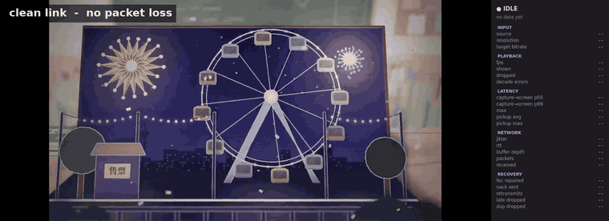
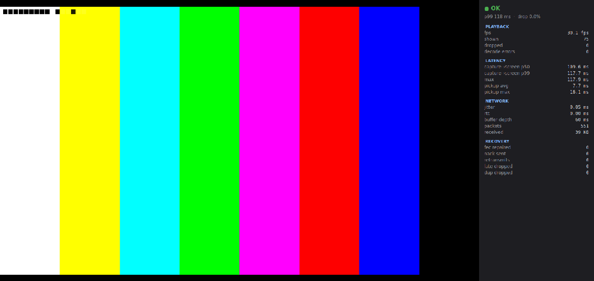

# lowlat-video

Linux 平台的低延迟实时视频传输系统。覆盖采集 → 编码 → 封装 → 传输 → 丢包恢复 → 解码 → 渲染全链路，重点实现传输层的 FEC、NACK 重传、自适应抖动缓冲与端到端延迟测量。



上面这段 GIF 是同一个程序两次运行，只把丢包档位从 `off` 切到 `20%`：

- **上半段**：链路干净，`target bitrate` 稳定在约 2700 kbps，恢复计数全为 0
- **下半段**：每 5 个包丢 1 个。`target bitrate` 掉到 **380 kbps**（拥塞控制自动降速），
  `nack sent` 与 `retransmits` 开始跳数，画面变块，但**帧率仍是 30fps**——
  这就是 FEC + NACK + 拥塞控制同时在工作的样子

静态截图（视频区 + 指标面板）：



*左侧实时视频（720p@30fps），右侧运行指标面板。截图来自 5% 丢包回环测试。*

## 核心结果

同样是 5% 丢包、300 帧、每档重复 2 次的回环测试（详见 [docs/benchmark.md](docs/benchmark.md)）：

| 恢复策略 | PSNR | NAL 送达率 |
|---|---|---|
| 无恢复 | 40.26 dB | 94.4% |
| 仅 XOR FEC | 48.32 dB | 98.9% |
| **FEC + NACK** | **60.97 dB** | **99.7%** |

2% 丢包下 FEC + NACK 可以做到**码流与参考流逐字节相同**（PSNR = inf）。30% 丢包下仍能把送达率从 71.5% 提升到 86.9%。

拥塞控制（1.2 Mbit 链路、20 秒内容）：固定码率会让队列累积 **7.6 秒**积压，开启后降到 **约 1 秒**，同时多送达 138 个 NAL。

## 架构

```
发送端                                        接收端
┌──────────┐   ┌────────┐   ┌────────────┐   ┌─────────────┐   ┌────────┐   ┌────────┐
│ 采集源   │──▶│ x264   │──▶│ FU-A 分片  │──▶│ UDP 收包     │──▶│ 解码   │──▶│ Qt 渲染│
│ 合成/V4L2│   │ 编码   │   │ RTP-lite   │   │ 重组/FEC/NACK│   │ libav  │   │ GL着色 │
└──────────┘   └────────┘   │ XOR FEC    │   │ 抖动缓冲     │   └────────┘   └────────┘
                            └────────────┘   │ 帧内重排     │        ▲
                                  ▲          └─────────────┘        │
                                  │                 │               │
                             NACK 重传 ◀────────────┘        有界帧槽（只留最新帧）
```

数据流单向，反向只有一条轻量 NACK 通道。

## 模块

| 模块 | 行数 | 职责 |
|---|---|---|
| `common` | 809 | 无锁 SPSC 环形队列、帧池、字节序、统计、日志 |
| `capture` | 1375 | 采集抽象、合成源（彩条+帧号+噪声）、V4L2 MMAP 采集、文件源（任意媒体文件解码） |
| `codec` | 683 | libx264 编码、libavcodec 解码 |
| `protocol` | 1694 | RTP-lite 头、FU-A 分片重组、XOR FEC、NACK 调度、抖动估计、RTT 估计、带宽估计、控制通道 |
| `transport` | 1816 | UDP socket、发送器、接收流水线、重传缓存 |
| `app` | 1057 | `lowlat_sender` / `lowlat_receiver` 命令行程序 |
| `ui` | 2337 | Qt6 界面、GL 渲染、指标面板、收包线程、进程内发送端 |

源码合计约 9771 行，含测试与工具约 14531 行。

## 文档

| 文档 | 内容 |
|---|---|
| [docs/protocol.md](docs/protocol.md) | 协议规范：RTP-lite 头字段逐字节布局、FU-A 分片、XOR FEC 载荷、反向控制通道、收发时序 |
| [docs/benchmark.md](docs/benchmark.md) | 四组压测：丢包档位扫描、抖动缓冲深度、端到端延迟构成、拥塞控制 |
| [docs/bench-raw.csv](docs/bench-raw.csv) | 36 次压测的原始数据（文档表格的来源，可复算） |
| [docs/interview.md](docs/interview.md) | 面试问答：常见追问、实测数据支撑、以及明确不该说什么 |

## 构建

依赖：CMake ≥ 3.20、g++ 13（C++17）、libx264、FFmpeg 开发库、Qt6。

```bash
./scripts/setup-deps.sh          # 安装依赖（需要 sudo）
cmake -S . -B build -G Ninja -DCMAKE_BUILD_TYPE=Release
cmake --build build -j
ctest --test-dir build           # 145 个用例
```

打包为 `.deb`（含 systemd 单元，运行时依赖由 `dpkg-shlibdeps` 自动推导）：

```bash
cmake -S . -B build-deb -G Ninja -DCMAKE_BUILD_TYPE=Release \
      -DLOWLAT_ENABLE_PACKAGING=ON -DLOWLAT_BUILD_TESTS=OFF
cmake --build build-deb -j
(cd build-deb && cpack -G DEB)

sudo dpkg -i build-deb/lowlat-video_0.1.0_amd64.deb
sudo systemctl start lowlat-receiver     # 默认监听 0.0.0.0:5000，启用 NACK
sudo systemctl status lowlat-receiver
```

服务以 `DynamicUser` 运行，状态目录 `/var/lib/lowlat` 由 systemd 自动创建，无需 `postinst` 建用户。收到 `SIGTERM` 会走优雅退出路径（冲刷输出文件后返回退出码 3）。

## 运行

```bash
# 0) 打开界面：点 "Open file..." 或把视频拖进窗口（推荐先试这个）
./scripts/demo.sh

# 0c) 用 Windows 摄像头做输入（关闭窗口会自动停止采集）
./scripts/camera.sh
./scripts/camera.sh --loss 20          # 顺便模拟 20% 丢包

# 0b) 命令行直接播某个文件，并模拟 5% 丢包（界面上的 Loss 下拉框同一个开关）
./build/src/ui/lowlat_ui --local 你的视频.mp4 --loss 5

# 1) 命令行落盘：发送 300 帧并接收保存
./build/src/app/lowlat_receiver --bind 127.0.0.1:5000 --output out/recv.h264 \
    --frames 300 --nack &
./build/src/app/lowlat_sender --frames 300 --dest 127.0.0.1:5000 --fec

# 2) 图形界面实时播放
./build/src/ui/lowlat_ui --bind 127.0.0.1:5000 --nack

# 2b) 播放本地文件（把文件当"摄像头"推流）
./build/src/app/lowlat_sender --source file --input 你的视频.mp4 --loop \
    --dest 127.0.0.1:5000 --fec

# 3) 弱网压测（自动创建独立 netns，扫描丢包档位）
./scripts/bench.sh
LEVELS="0 5" REPS=1 FRAMES=150 ./scripts/bench.sh   # 快速验证

# 3b) 抖动缓冲对照：固定窗口 vs 自适应窗口
./scripts/jitter_test.sh --mode fixed    --delay none
./scripts/jitter_test.sh --mode adaptive --k 6

# 4) 码流校验工具
./build/tools/h264_probe out/recv.h264
```

## 关键设计取舍

**RTP-lite 而非标准 RTP**。头固定 12 字节 + 8 字节扩展（帧号 + 采集时间戳），解析零分支。代价是不能与标准 RTP 端点互通——本项目只与自己通信。差异逐条写在 `src/protocol/rtp_lite.hpp` 注释里。

**FEC 修复包不占数据序列号**。复用同组最后一个数据包的序列号，这样"序列号是否连续"仍然只反映真实丢包，不会被修复包插队误判。

**帧保持窗口同时服务两件事**：吸收抖动乱序、等 NACK 重传。因此深度公式是 `max(k×jitter, rtt+margin)`，只按抖动算会把重传饿死。

**NACK 延迟发送**。检测到缺口后等 8ms 再请求，否则网络抖动造成的乱序会被误判成丢包，形成"误判 → 重传 → 更乱序"的正反馈。

**UI 只保留最新帧**。解码快于渲染时覆盖旧帧而非排队——排队会让延迟单调增长且不可恢复。

**单进程模式把发送端放进 UI 进程**。`--local` 时文件源 → 编码 → UDP(127.0.0.1) → 收包 → 解码 → 渲染全部在一个进程里完成。链路绕了一圈回到原处，但中间的 UDP 与协议栈是真的，所以指标不是模拟出来的。这样做是为了让"开一个窗口就能看到效果"成立——原来要开两个终端，对使用者不成立。

**拥塞控制基于延迟梯度而非丢包**。接收端每帧记录 `(采集时刻, 到达时刻)`，每 8 帧或 300ms 回传一批样本；发送端用 `Σ[(到达间隔) - (发送间隔)]` 判断队列是否在堆积，过载时乘性降速、正常时加性提速。只看丢包的话，等到丢包发生时队列已经堆满了。

**降速带冷却、严重度过冲限两步**。实测两个必要的补丁：大过冲后队列要几秒才排空，期间检测器仍看到正值延迟会连续下调到底；一次砍太多也会远离真实工作点（1.2Mbit 链路曾被砍到 300kbps 下限）。

## 测试

145 个单元/集成测试，覆盖分片重组、FEC 编解码、NACK 调度、抖动估计、SDK 往返、接收流水线（真实 UDP）。并发相关代码通过 ThreadSanitizer 验证无数据竞争。

```bash
ctest --test-dir build
setarch "$(uname -m)" -R ./build-tsan/tests/lowlat_tests --gtest_filter='SpscRingBuffer.*:FrameSlot.*'
```

## 已知限制

1. **V4L2 采集未在真实设备跑通**。代码完整：8 个 ioctl 全实现（`QUERYCAP`/`S_FMT`/`REQBUFS`/`QUERYBUF`/`QBUF`/`DQBUF`/`STREAMON`/`STREAMOFF`），采集走 mmap 零拷贝。格式协商支持 **YUV420 / YUYV / MJPEG** 三种（UVC 摄像头实测只提供后两种），非 YUV420 通过 `V4l2Converter` 转成 I420，转换逻辑有 11 个单元测试。
   但**实机始终没跑通**：开发机是 WSL2，只能靠 `usbipd` 透传摄像头。透传本身成功（`uvcvideo` 正确绑定 UVC 1.50），透传成功、`uvcvideo` 正确绑定 UVC 1.50，但**数据在等时传输中被截断**：ffmpeg 报 `Dequeued v4l2 buffer contains corrupted data`，320×240 的一帧应当有 10~20 KB，实际 `bytesused` 只有 64~80 字节（USB 包头的量级）。这种截断发生在驱动层之下，换任何像素格式都救不回来。**结论：WSL2 + USB/IP 无法可靠承载视频流。**
   **替代方案是文件源**（`--source file` / `--local`），可以播放任意视频文件验证整条链路，且链路本身完全一致。
2. **渲染走软件光栅化**（llvmpipe），无硬件 GPU 加速。720p 全屏清屏实测 4.76ms/帧，30fps 预算占用 14%。
3. **色彩矩阵固定 BT.601 有限范围**，未从 SPS VUI 读取。接外部视频源时颜色会偏。
4. **拥塞控制只验证了 loopback 限速**，没有真实跨机链路数据。收敛偏保守：1.2 Mbit 链路上稳定在 800–880 kbps（约容量的 70%）。
5. **`x264_encoder_reconfig` 在本机 x264 164 上改码率无效**，`set_bitrate` 采用重建编码器的方式（代价是一次 SPS/PPS + IDR）。这个坑由 `tests/test_encoder.cpp` 的 `RuntimeBitrateReconfigActuallyChangesOutput` 守护。
5. **延迟口径是"采集 → 落盘"与"采集 → 上屏"**，不含物理显示延迟，不是 glass-to-glass。
6. 压测每档仅 2 次重复，PSNR 存在方差。

## 目录

```
src/         实现
tests/       gtest 用例
tools/       h264_probe（码流校验）、qt_probe（GL 可行性探针）
scripts/     setup-deps.sh、bench.sh
docs/        压测数据与方法
```
